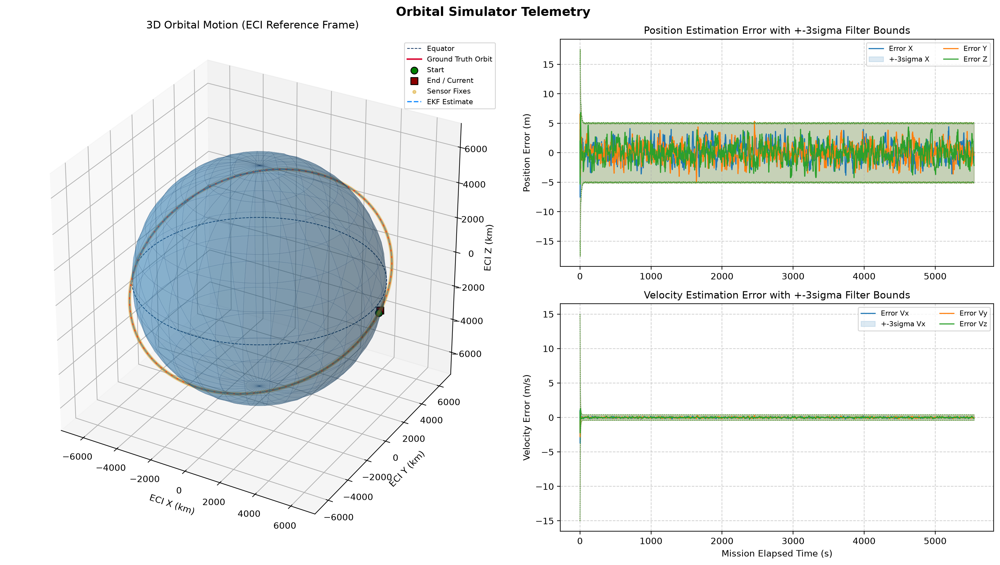

# Orbital State Estimator & Sensor Telemetry Simulator

A modular, Software-in-the-Loop (SIL) orbital dynamics simulator and state estimation pipeline developed in Python. The system integrates satellite motion under two-body gravity and Earth oblateness ($J_2$) perturbations, emulates discrete sensor noise characteristics, and reconstructs true trajectory using an Extended Kalman Filter (EKF).

---

## Visual Output


*Figure 1: 3D orbit trajectory around WGS-84 reference Earth and corresponding EKF estimation residuals bounded by $\pm 3\sigma$ covariance limits.*

---

## Architecture Overview

The idea is:
[ Dynamics Engine (RK4) ] ──(True State @ 50 Hz)──> [ Sensor Rig (GPS Emulation) ]
│
▼
[ EKF Estimator ] ──> [ State Estimate & Covariance ]

* **Basic Physics (`dynamics.py`):** Deterministic 4th-order Runge-Kutta (RK4) numerical integrator solving orbital equations of motion with $J_2$ geopotential perturbations.
* **Sensor Emulation (`sensors.py`):** Simulates hardware-level sampling rates and zero-mean Gaussian measurement noise $\mathcal{N}(0, R)$, injecting realistic clock and atmospheric jitter.
* **Flight Software Estimator (`estimator.py`):** Extended Kalman Filter decoupled from the truth model. Propagates state covariance during high-rate physics steps and executes measurement updates upon telemetry arrival.
* **Coordinator Loop (`run_sim.py`):** Dispatches simulation events across multi-rate clock ticks and records state vectors for post-flight analysis.

---

## Repository Structure

```text
orbital_sim/
├── config.py          # Physical constants (WGS-84), orbital initial states, simulation parameters
├── dynamics.py        # Truth engine: equations of motion and RK4 integrator
├── sensors.py         # Hardware emulation: multi-rate polling and measurement noise injection
├── estimator.py       # Flight software: EKF prediction, update, and covariance tracking
├── visualizer.py      # Telemetry diagnostics: 3D Earth mesh and residual error plots
├── run_sim.py         # Simulation coordinator and event loop
├── docs/              # Figures and design documentation
│   └── sample_plot.png
└── requirements.txt   # Runtime dependencies
```

---

## Getting Started

### Prerequisites

* Python 3.10+
* `numpy`
* `matplotlib`

### Running the Simulation
Just use the following command (with additional config options defined inside):
```python
python run_sim.py
```
